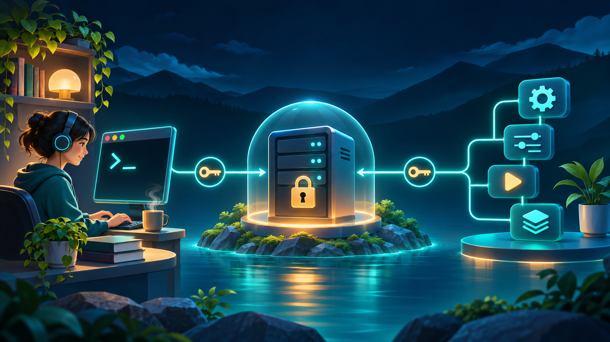

# LCCS SSH Playground



**Learn SSH by doing it.** Start a disposable lab with one Docker Compose command, connect from your terminal, then run the same task from n8n. The first challenge is **First Contact**. No remote server or existing n8n account is required.

| What starts | Where you reach it |
| --- | --- |
| SSH lab target | Your terminal connects to `127.0.0.1:2222` |
| Private n8n learning instance | Open `http://localhost:5680` |
| Key generator | Creates separate console, automation, and server keys in ignored local `state/` |

The SSH and n8n ports bind to your machine's loopback interface. Generated private keys stay on your machine and are excluded from Git and the Docker build context.

## New to Docker?

Follow the [setup guide](docs/install.md) for Windows with WSL, macOS, Ubuntu, Debian, and Fedora. It explains how to install Docker and Compose, Git, an SSH client, and the small optional tools used by the helper commands.

On a Mac, use the [step-by-step Mac walkthrough](docs/mac.md) from installation through the first n8n run.

Already have Docker? Check that these commands work before continuing:

```bash
docker version
docker compose version
ssh -V
```

## Quick start

Run these commands in a terminal. On Windows, use an Ubuntu WSL terminal with Docker Desktop's WSL integration enabled.

```bash
git clone https://github.com/low-country-cyber/lccs-ssh-playground.git
cd lccs-ssh-playground
docker compose up -d
./lab doctor
```

The first startup downloads the n8n image and builds a small SSH image, so it may take a few minutes. The `key-init` service exits after generating keys; that is expected. `./lab doctor` checks both SSH identities and waits for n8n to become healthy.

### Step 1: connect from your terminal

```bash
./lab console
```

In the lab shell, try:

```sh
whoami
hostname
cat README.txt
```

Type `exit` when finished. The terminal helper uses a generated, pinned host key. It will refuse an unexpected SSH server identity.

### Step 2: connect from n8n

1. Open [http://localhost:5680](http://localhost:5680) and create the owner account for this new lab instance.
2. Run `./lab import-credential` in your terminal. This imports the dedicated automation key into the owner's personal credentials without displaying the private key or needing an n8n API key. Refresh n8n afterward.
3. In the n8n editor, import [`workflows/01-first-contact.json`](workflows/01-first-contact.json). Open its SSH node and select **SSH Playground Automation** as the credential.
4. Execute the workflow manually. Its output should show `automation` and the lab target's hostname.

The workflow file contains no credential ID and is not scheduled or published. The n8n container reaches the SSH target at `ssh-target:22` on the Compose network; your terminal reaches it at `127.0.0.1:2222` through the host port mapping.

Prefer to create the credential in the n8n UI yourself? Run `./lab credential-info` to see the exact fields and the local path to the automation private key. Keep that key out of chat, screenshots, and Git.

## Helpful commands

| Command | What it does |
| --- | --- |
| `./lab status` | Shows the lab containers |
| `./lab doctor` | Checks both SSH logins and n8n health |
| `./lab automation 'whoami && hostname'` | Runs a command with the automation identity |
| `./lab credential-info` | Shows n8n SSH credential fields without printing a secret |
| `docker compose logs --tail=50 ssh-target` | Shows recent SSH server logs |
| `docker compose down` | Stops the lab while keeping keys and n8n data |

Running `docker compose up -d` again preserves all three SSH key pairs. To start completely fresh, follow the [reset instructions](docs/troubleshooting.md#start-fresh); a reset removes lab accounts, workflows, credentials, and keys.

## More help

- [First Contact challenge](challenges/01-first-contact.md)
- [Installation guide](docs/install.md)
- [Mac walkthrough](docs/mac.md)
- [Troubleshooting and reset](docs/troubleshooting.md)
- [Security boundaries](SECURITY.md)

This is a local training project. It does not change your host SSH server or connect to real infrastructure. The code and documentation are released under the [MIT license](LICENSE).
