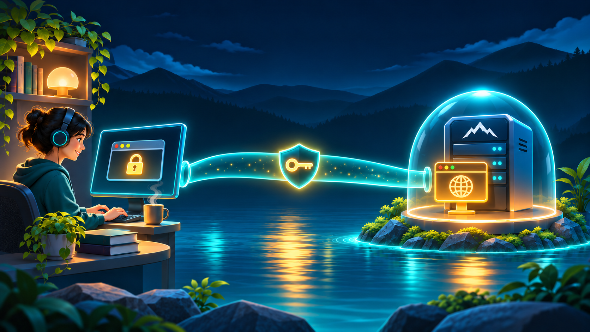

# Challenge 06: Reach a private web service



## Goal

Use an SSH local port forward to open a web page that listens only inside the Alpine target. You will use one terminal to keep the tunnel open and another to visit the page from your own computer.

## 1. Start the lab

From a fresh clone of the playground:

```bash
docker compose up -d
./lab doctor
./lab ssh-config > state/ssh_config
chmod 600 state/ssh_config
```

The demo web service runs on `127.0.0.1:8080` **inside Alpine**. Docker does not publish that port on your computer.

## 2. Check the page from inside Alpine

```bash
ssh -F state/ssh_config playground 'wget -qO- http://127.0.0.1:8080/'
```

Look for **LCCS SSH Playground private service** in the HTML. This command works because `wget` runs on the Alpine target, where the page is listening.

## 3. Open the tunnel in Terminal A

Keep this terminal open in the playground directory:

```bash
ssh -F state/ssh_config -o ExitOnForwardFailure=yes -N \
  -L 127.0.0.1:18080:127.0.0.1:8080 playground
```

The blank screen is expected. `-N` means the SSH connection carries the tunnel without opening a remote shell. The first address, `127.0.0.1:18080`, is on **your computer**. The second, `127.0.0.1:8080`, is on the **Alpine target**.

## 4. Visit the page in Terminal B

Open a second terminal on your computer and run:

```bash
curl -fsS http://127.0.0.1:18080/
```

You can also open [http://127.0.0.1:18080/](http://127.0.0.1:18080/) in your browser. You should see **Private web service reached**. Your browser connects to the local port; SSH carries that request to the target's private page.

## 5. Close the tunnel

Return to Terminal A and press **Ctrl+C**. In Terminal B, confirm the local route is gone:

```bash
curl --max-time 2 -fsS http://127.0.0.1:18080/ || echo 'Tunnel is closed.'
```

The page remains available inside Alpine. Closing SSH only removes your local route to it.

## n8n companion

You can test n8n after finishing the command line lessons. After creating the owner account, run `./lab setup-n8n` and refresh n8n. Open **SSH Playground - 06 - Private Service** and execute it manually. The workflow connects as `automation` and reads the page from inside Alpine; it does not need your host-terminal tunnel.

## Explain what happened

- Which `127.0.0.1` belongs to your computer, and which belongs to Alpine?
- Why does `curl http://127.0.0.1:18080/` stop working when SSH closes?
- Why can the n8n workflow reach the page without using your local forward?

If port `18080` is already in use, choose another unused local port in both the `-L` and `curl` commands. The target-side `127.0.0.1:8080` stays the same. If the tunnel fails, run `./lab doctor` and check the [troubleshooting guide](../docs/troubleshooting.md).

Next, try [Challenge 07: Reach a hidden SSH target](07-jump-to-a-hidden-target.md) to use the first server as a route to a second one.
