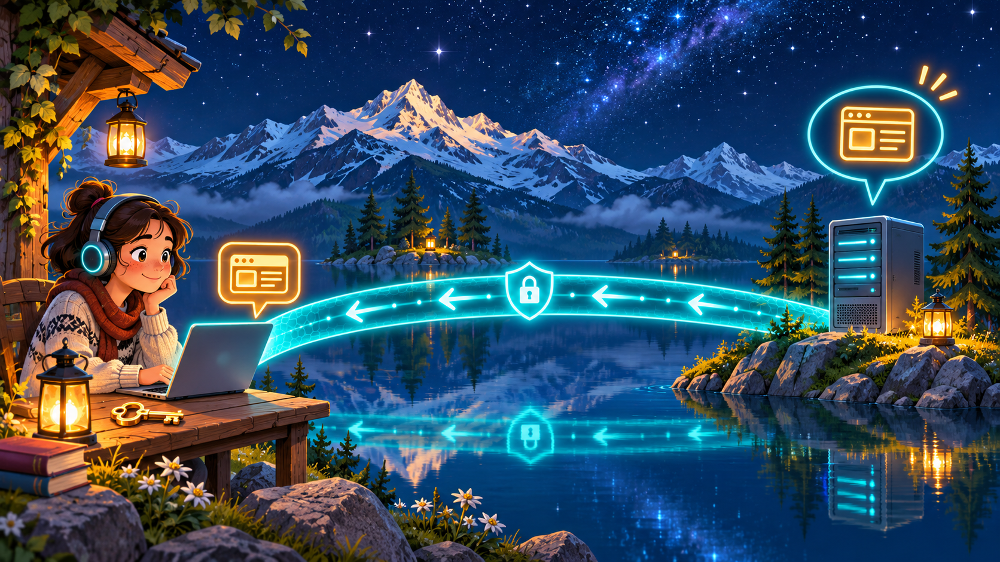

# Challenge 10: Share a host page with Alpine



## Goal

Serve a harmless web page on your computer and let the Alpine target reach it through an SSH reverse forward. You will see which side owns each port, then let n8n check the same route while the tunnel is open.

The commands below use `~/lccs-ssh-playground`, the folder created by the README Quick Start. If you cloned elsewhere, replace that path in each `cd` line. A new terminal may open in `~`, so each terminal block begins by entering the playground directory.

## 1. Start the lab and host page in Terminal A

From a fresh playground clone, run **this entire block** in the repository directory:

```bash
cd ~/lccs-ssh-playground
docker compose up -d
./lab doctor
./lab ssh-config > state/ssh_config
chmod 600 state/ssh_config
python3 -m http.server 19090 --bind 127.0.0.1 --directory services/host-demo
```

The last command keeps Terminal A busy while it serves the checked-in practice page. Open [the host page](http://127.0.0.1:19090/) in your browser, or run `curl -fsS http://127.0.0.1:19090/` in another terminal. It says **Host practice page**. The web server listens only on your computer's loopback address.

## 2. Open the reverse tunnel in Terminal B

Open a second terminal in the playground directory and run:

```bash
cd ~/lccs-ssh-playground
ssh -F state/ssh_config -o ExitOnForwardFailure=yes -N \
  -R 127.0.0.1:18090:127.0.0.1:19090 playground
```

Leave this command running. The first `127.0.0.1:18090` is a listener **inside Alpine**. The second `127.0.0.1:19090` is the web server **on your computer**. A request to Alpine's port travels back over this SSH connection to your host page. `-N` keeps the connection open without starting a remote shell; `ExitOnForwardFailure=yes` reports a listener setup failure immediately.

## 3. Verify the route in Terminal C

Open a third terminal in the playground directory and run:

```bash
cd ~/lccs-ssh-playground
curl -fsS http://127.0.0.1:19090/ | grep 'LCCS SSH Playground host page'
ssh -F state/ssh_config playground 'wget -qO- http://127.0.0.1:18090/' | grep 'LCCS SSH Playground host page'
```

Both commands should print the same page marker. The first reads the host page directly. The second runs `wget` **inside Alpine**, where `127.0.0.1:18090` is the reverse tunnel's listener. No extra Docker port is published for this page.

## n8n companion

Keep Terminals A and B running. After creating the n8n owner account, run `./lab setup-n8n` from the playground directory in Terminal C and refresh n8n. Open **SSH Playground - 10 - Reverse Tunnel** and execute it manually. Its SSH node runs `wget` on Alpine and should return the host page marker.

This workflow uses the **SSH Playground Automation** credential to connect to Alpine. It can read the listener created by your separate `learner` SSH connection; it does not open its own tunnel. If you test all n8n workflows later, restart the host page and reverse tunnel from steps 1 and 2 before running this one.

## 4. Close the tunnel and host page

Press **Ctrl+C** in Terminal B to close the SSH tunnel. While the Python server is still running in Terminal A, check the difference from Terminal C:

```bash
cd ~/lccs-ssh-playground
curl -fsS http://127.0.0.1:19090/ | grep 'LCCS SSH Playground host page'
ssh -F state/ssh_config playground 'wget -qO- http://127.0.0.1:18090/' || echo 'Reverse tunnel is closed.'
```

The host page still answers the first command, but Alpine can no longer reach it through port `18090`. Press **Ctrl+C** in Terminal A when finished.

## Explain what happened

- Which `127.0.0.1` belongs to your computer, and which belongs to Alpine?
- Why does the host page still work after you close only the SSH tunnel?
- Why can n8n read Alpine's listener only while the learner tunnel is active?

If the tunnel or page fails, run `./lab doctor` and use the [troubleshooting guide](../docs/troubleshooting.md). Keep generated private keys in `state/` out of screenshots and Git.
